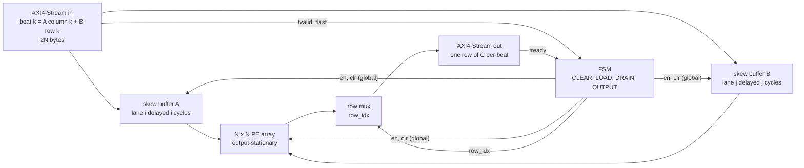
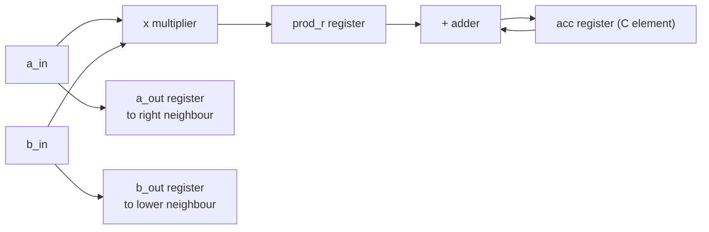
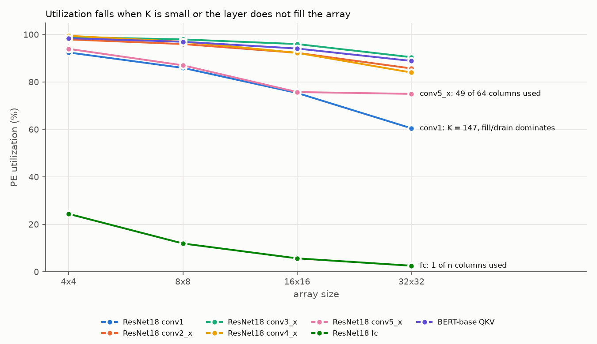
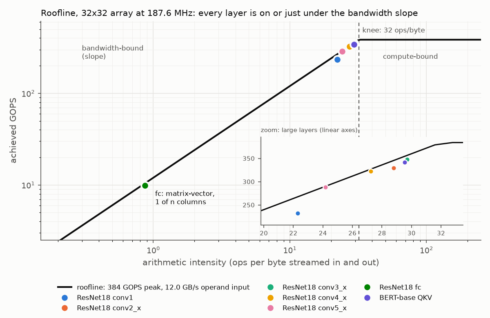
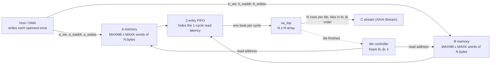

# Systolic-Array INT8 GEMM Accelerator

A parameterized **N×N output-stationary systolic array** for signed INT8 matrix
multiplication with an **AXI4-Stream** interface, verified with **cocotb + pyuvm**,
checked with **formal properties (SymbiYosys)**, synthesized with **Yosys** on the
**SkyWater 130 nm** library, and analysed with a **cycle-accurate model** and a
**roofline performance model**.

> Status: RTL, verification, formal proof, synthesis/timing and performance analysis are done, plus two stretch goals: an INT32 → ReLU → INT8 requantization stage and a tiled GEMM engine with on-chip operand buffers (see [`PATHWAY.md`](PATHWAY.md)). Weight-stationary, OpenLane and a C++ model are open.

---

## Architecture

```
            B[k][0]  B[k][1]  B[k][2]  B[k][3]       (top edge, skewed by column)
               |        |        |        |
A[0][k] ---> [PE00]-->[PE01]-->[PE02]-->[PE03]
               |        |        |        |
A[1][k] -D-> [PE10]-->[PE11]-->[PE12]-->[PE13]       D = one-cycle skew register
               |        |        |        |
A[2][k] -DD> [PE20]-->[PE21]-->[PE22]-->[PE23]       each PE:  acc += a * b
               |        |        |        |                    forward a ->, b v
A[3][k] DDD> [PE30]-->[PE31]-->[PE32]-->[PE33]
```

* **Output-stationary:** each PE keeps one element of C in its accumulator.
* **Skew buffers:** row *i* / column *j* are delayed *i* / *j* cycles so that
  `A[i][k]` and `B[k][j]` meet in `PE(i,j)`.
* **Global enable:** input bubbles (`tvalid=0`) freeze the whole pipeline, so
  stalls never corrupt results.

### Block diagrams



One PE (`PIPE=1`): the product is registered before it is accumulated.



### Interface

| Port | Width | Meaning |
|---|---|---|
| `s_axis_tdata` | `2·N·8` | beat *k*: column *k* of A (low half) + row *k* of B (high half) |
| `s_axis_tlast` | 1 | last beat of the job (k = K−1) |
| `m_axis_tdata` | `N·32` | one row of C per beat |
| `m_axis_tlast` | 1 | last row |
| `last_job_cycles` | 32 | measured latency of the previous job |

### FSM

`CLEAR → LOAD (K beats) → DRAIN → OUTPUT (N rows) → CLEAR`,  DRAIN = (2N-2, or 1 if N=1) + `PIPE`

Latency without stalls: **K + DRAIN + N cycles**: K + 3N - 1 with the pipelined PE (`PIPE=1`, default), K + 3N - 2 without it, for N >= 2 (checked cycle by cycle against the model).

---

## Repository layout

```
rtl/            pe.sv, skew_buffer.sv, systolic_array.sv, sa_top.sv (+ formal props)
                quant_relu.sv, sa_layer.sv      requantization stage, GEMM + requantization
                sram_sp.sv, sa_gemm.sv          operand memory, tiled GEMM engine
model/          sa_cycle_model.py   cycle-accurate Python mirror of the RTL
tb/common/      sa_utils.py         packing, golden model, AXI-Stream driver/monitor
tb/cocotb/      test_sa_top.py      directed + random + stall/back-pressure tests + cycle-accurate lockstep
                test_quant.py, test_sa_layer.py, test_sa_gemm.py   the stretch modules
tb/pyuvm/       test_sa_pyuvm.py    UVM-style env: agent, driver, monitor, scoreboard, coverage
formal/         sa_top.sby, quant_relu.sby, sa_gemm.sby   SymbiYosys prove + cover
synth/          run_synth.sh, sweep_fmax.sh, area_breakdown.sh, sta.tcl, abc_speed.script
                                    Yosys synthesis (sky130) + OpenSTA timing
analysis/       perf_model.py, summarize_synth.py, merge_coverage.py, bug_injection.py
docs/           bug_injection.md    which test catches which injected RTL bug
setup/          install_tools.sh, check_tools.sh
```

## Quick start (WSL2 Ubuntu)

```bash
bash setup/install_tools.sh          # one time
source ~/.bashrc
make check                           # confirm the toolchain
make model                           # cycle-model self-test (numpy only)
make test                            # cocotb regression, N=4
make sweep                           # N = 2, 4, 8
make uvm                             # pyuvm regression
make cov                             # pyuvm at N = 2, 4, 8 + merged coverage closure check
make quant                           # requantization stage, QSTAGES = 1, 2, 3
make layer                           # GEMM + requantization, QSTAGES = 1, 2, 3
make gemm                            # tiled GEMM with on-chip buffers (MAXK= MAXMB= MAXNB=)
make bugs                            # bug-injection check of the testbenches
make formal                          # SymbiYosys
make synth                           # Yosys + sky130 + OpenSTA (PIPE=0|1, CLK_PERIOD=<ns>)
make fmax                            # PIPE=0 vs PIPE=1: area, Fmax, plot
make perf                            # performance model + plots in results/
```

## Verification

| Layer | What it checks |
|---|---|
| cocotb (7 tests) | identity, K=1, extreme values, 50 back-to-back jobs with the exact latency `K + DRAIN + N`, random bubbles + back-pressure, reset mid-job |
| cycle-accurate lockstep | `test_cycle_accurate_vs_model` compares `tready`, `tvalid`, `tlast`, `last_job_cycles` and `tdata` with `model/sa_cycle_model.py` on **every clock cycle**, with garbage on `tdata`/`tlast` while `tvalid` is low |
| pyuvm (3 tests) | agent / driver / monitor / scoreboard against a NumPy golden model: random + corner, random stalls, and directed stall patterns (valid toggling every cycle, long gaps, `tready` held low 8 / 30 / 50 cycles mid-output) |
| functional coverage | 27 bins (K, K vs N, operand extremes, sign mix, input bubbles per job, back-pressure cycles per job, stall patterns), merged over the tests by `make cov`; closure is checked per N |
| formal (SymbiYosys) | 7 properties proved by k-induction (AXI-Stream output stability, no input while producing output, `tlast` framing, row index range, FSM returns to CLEAR, accumulators frozen when stalled, `tready` low during DRAIN); a cover trace completes a job |
| bug injection | 36 one-line RTL mutations (12 array, 10 quantizer, 3 layer, 11 tiled GEMM), all caught - see [docs/bug_injection.md](docs/bug_injection.md) |

All of it passes for N = 2, 4, 8. Two examples of why the layers are needed: a DRAIN that is one
cycle too long is functionally correct and only a latency check or the lockstep test sees it;
`tready` high during DRAIN is invisible to the cocotb tests (they send the next job only after
the previous one has finished) and is caught by the lockstep test and by the pyuvm driver, which
overlaps jobs.

## Results

All numbers: SkyWater sky130 HD, typical corner (tt, 25 C, 1.8 V), Yosys + ABC (timing-driven, fan-out
buffered, `lpflow_*` cells excluded), OpenSTA 2.3.1 on the synthesized netlist. Ideal clock, zero I/O
delay, no placement or wire parasitics, so these are pre-layout estimates. Fmax is flop-to-flop
(`1000 / (period - slack)`).

| N | Tests | Cells | Area (µm²) | Fmax (MHz) | Peak GOPS @ Fmax |
|---|---|---|---|---|---|
| 2 | 7 cocotb + 3 pyuvm, all pass | 3,142 | 25,717 | 196.4 | 1.6 |
| 4 | 7 cocotb + 3 pyuvm, all pass | 11,555 | 96,545 | 193.8 | 6.2 |
| 8 | 7 cocotb + 3 pyuvm, all pass | 47,228 | 385,388 | 187.6 | 24.0 |

(PIPE=1, the shipped configuration. Peak GOPS = 2 x N² x Fmax: one MAC = 2 ops per PE per cycle.)

### PE pipelining: before / after

`PIPE=0` adds the product to the accumulator in the same cycle; `PIPE=1` registers the product first
(`prod_r` in `rtl/pe.sv`) and adds it one cycle later. Cost: one extra DRAIN cycle, so latency goes from
`K + 3N - 2` to `K + 3N - 1` (N >= 2).

| N | Area PIPE=0 (µm²) | Area PIPE=1 (µm²) | Fmax PIPE=0 (MHz) | Fmax PIPE=1 (MHz) | Fmax gain |
|---|---|---|---|---|---|
| 2 | 29,951 | 25,717 | 114.2 | 196.4 | 1.72x |
| 4 | 113,347 | 96,545 | 110.0 | 193.8 | 1.76x |
| 8 | 453,150 | 385,388 | 96.5 | 187.6 | 1.94x |


* **Critical path before** (N=4, 9.1 ns): operand register -> AND partial products -> compressor tree of the
  multiplier -> ~30 `maj3` carry stages of the 32-bit accumulate -> accumulator register. That is the
  expected multiplier -> adder -> register path.
* **Critical path after** (5.2 ns): operand register -> multiplier -> `prod_r`. The accumulate stage is no
  longer on the critical path; the multiplier alone now limits Fmax, so the next step would be to split the
  multiplier itself (Booth encoding / a carry-save stage).
* **Why the pipelined design is also smaller** (−15 % at N=8) even though it has 256 more flops: with
  `PIPE=0` Yosys merges each PE's multiply and add into a single `$macc` cell (visible in the synthesis
  log), a larger structure than a separate multiplier and adder. The register breaks that merge. This is a
  tool effect, so it should not be generalised to other flows.
* **What dominates the area** (N=8, hierarchical run, `synth/area_breakdown.sh`): the 64 PEs are 90 % of the
  total (5,617 µm² each: 28 % flops, 72 % combinational multiplier + adder + enable muxes), the two skew
  buffers 5 %, the top-level control and output row mux 5 %. Area per PE is ~6,000 µm² at N=4 and N=8, i.e.
  area is linear in N².
* **Other path groups.** The AXI inputs feed the global `en`, which fans out to every register. Without
  buffering that net alone gave a 170 ns "critical path", which is a flow artifact: the timing-driven ABC
  script (`synth/abc_speed.script`) buffers and sizes it. With `PIPE=1` the input-to-register slack is
  positive at every size, so the core is the limit; with `PIPE=0` the input path (which also runs
  through the multiplier) is only 0.3-0.7 ns behind it.
* **Caveats.** Clock is ideal and I/O delays are zero. The mapped result did not change with the clock
  target (3, 5 and 8 ns gave the same netlist at N=4), so one target is used. Synthesis only: there is no
  placement, routing, or wire load yet (OpenLane would add those).

## Performance analysis

`analysis/perf_model.py` lowers CNN/Transformer layers to GEMM (im2col), tiles them onto an n x n array and
counts cycles. Its tile cost is checked against the RTL: `make perf` ends with `Model matches RTL cycle
counts` (50 simulated jobs at each of N = 2, 4, 8). Clock: **187.6 MHz**, the Fmax measured for the 8x8
design. Larger arrays were not synthesized (Fmax fell from 196 to 188 MHz between N=2 and N=8), so the 16x16
and 32x32 figures assume the same clock and are somewhat optimistic. GOPS are modelled, not measured on
hardware.

### Where utilization goes

One tile costs `K + 3n` cycles (1 CLEAR + K LOAD + 2n-1 DRAIN + n OUTPUT). Utilization is therefore exactly

```
utilization = K / (K + 3n)   x   padding efficiency
              (fill + drain)     (M / (n*ceil(M/n))) * (Nc / (n*ceil(Nc/n)))
```

(checked against the model for all 28 layer/size points: the difference is below 1e-15). At n = 32:

| Layer (M x K x Nc) | K / (K+3n) | padding | **utilization** | GOPS (peak 384) | at 8x8 |
|---|---|---|---|---|---|
| ResNet18 conv1 (64 x 147 x 12544) | 60.5 % | 100 % | **60.5 %** | 232 | 86.0 % |
| ResNet18 conv2_x (64 x 576 x 3136) | 85.7 % | 100 % | **85.7 %** | 329 | 96.0 % |
| ResNet18 conv3_x (128 x 1152 x 784) | 92.3 % | 98.0 % | **90.5 %** | 348 | 98.0 % |
| ResNet18 conv4_x (256 x 2304 x 196) | 96.0 % | 87.5 % | **84.0 %** | 323 | 97.0 % |
| ResNet18 conv5_x (512 x 4608 x 49) | 98.0 % | 76.6 % | **75.0 %** | 288 | 87.0 % |
| ResNet18 fc (1000 x 512 x 1) | 84.2 % | 3.1 % | **2.6 %** | 10 | 11.9 % |
| BERT-base QKV (2304 x 768 x 128) | 88.9 % | 100 % | **88.9 %** | 342 | 97.0 % |



* **Small K (conv1, K = 147):** the 3n fill/drain/output cycles per tile are not amortized, so a bigger
  array loses more (at n = 32 the overhead is 96 of 243 cycles).
* **Layer smaller than the array (conv5_x):** the feature map is 7x7 = 49 output columns, which fill 49 of
  the 64 columns of two 32-wide tiles. This is the "32x32 array on a 7x7 layer" case: 76.6 % padding
  efficiency, 75 % overall even though K is large.
* **Matrix-vector (fc, Nc = 1):** only one of n columns does useful work, so utilization is about 1/n
  (2.6 % at n = 32). Batching images, which widens Nc, is the fix, not a different array.

### Roofline: the design is interface-bandwidth bound



The array consumes `2n` bytes per cycle (n values of A and n of B) to perform `n²` MACs, so the 32x32 array
needs 64 B/cycle = **12.0 GB/s** at 187.6 MHz for its 384 GOPS peak (48 GB/s at n = 128: the
requirement grows linearly with n). Every tile re-streams its operands, so the arithmetic intensity is
`nK / (K + 2n)` ops/byte, always below `n` ops/byte, which is exactly where the roofline's knee sits. All
layers therefore lie on the bandwidth slope, or just under it because of fill/drain and padding; the large
layers reach 22-30 ops/byte, `fc` only 0.9.

### What would raise the intensity

In this dataflow each element of A is streamed once for every column tile that uses it (`ceil(Nc/n)`
times) and each element of B once per row tile (`ceil(M/n)` times). Holding an operand panel in on-chip
SRAM, or making one operand stationary (weight-stationary: load a weight tile once, stream all activations
past it, accumulate partial sums on chip), removes that re-streaming. Upper bound with an unbounded
buffer (every operand read once, C written once), 32x32 array:

| Layer | streamed now (MB) | ideal reuse (MB) | reduction | ops/byte now | ops/byte ideal |
|---|---|---|---|---|---|
| conv1 | 10.59 | 5.06 | 2.1x | 22.3 | 46.6 |
| conv2_x | 8.03 | 2.65 | 3.0x | 28.8 | 87.4 |
| conv3_x | 7.78 | 1.45 | 5.4x | 29.7 | 159.2 |
| conv4_x | 8.49 | 1.24 | 6.8x | 27.2 | 186.1 |
| conv5_x | 9.57 | 2.69 | 3.6x | 24.2 | 86.1 |
| fc | 1.18 | 0.52 | 2.3x | 0.9 | 2.0 |
| BERT QKV | 15.34 | 3.05 | 5.0x | 29.5 | 148.6 |

Every layer except `fc` would move to the right of the knee (32 ops/byte), i.e. become compute-bound.
This is an upper bound: a real buffer is finite, and a weight-stationary array pays weight-load cycles
(normally hidden with double buffering) that this model does not count. A buffered version is implemented in
`sa_gemm` (next sections); the weight-stationary variant is not.

## Layer engine: INT32 → ReLU → INT8 (`quant_relu`, `sa_layer`)

`quant_relu` is an AXI4-Stream stage behind `sa_top`: each beat is a row of N 32-bit accumulators in, N INT8
values out, with

```
y = saturate_to_[-128,127]( floor( (relu(x) + 2^(shift-1)) / 2^shift ) )      cfg_shift 0..31, cfg_relu 0/1
```

`sa_layer` is `sa_top` + `quant_relu`; its latency is `sa_top`'s plus `QSTAGES` cycles, with unchanged throughput.

**A timing lesson (same as the PE pipelining).** The first version computed `x + 2^(shift-1)` with a 33-bit adder,
then a variable shifter, then a compare. Synthesized, the layer engine ran at **81 MHz** (N=4, 82 MHz at N=8) against 194 /
188 MHz for the array alone, because the stage sits behind the row-select mux of the accumulators and the
rounding adder is in series with it. Three pipeline stages only got it to 122 / 97 MHz. The fix was algebra, not
registers: `floor((v + 2^(s-1)) / 2^s) = floor(v / 2^s) + v[s-1]`, i.e. rounding is a carry-in of one bit. The
datapath now shifts `{v, 0}` once (the extra LSB becomes the round bit), decides saturation from the upper bits, and
only needs an **8-bit** increment. Result (sky130, OpenSTA, ideal I/O, 5 ns target):

| Pipeline registers (`QSTAGES`) | `quant_relu` area N=4 / 8 (µm²) | stage alone, input→reg (MHz) | `sa_layer` Fmax N=4 / 8 (MHz) | `sa_layer` area N=4 / 8 (µm²) |
|---|---|---|---|---|
| 1 (default) | 11,083 / 21,712 | 308 / 288 | 185 / 184 | 104,740 / 402,430 |
| 2 | 14,529 / 28,729 | 542 / 510 | 191 / 190 | 109,465 / 411,492 |
| 3 | 16,087 / 31,859 | 533 / 493 | 186 / 189 | 111,120 / 414,197 |
| `sa_top` alone (reference) | - | - | 194 / 188 | 96,545 / 385,388 |

With one register the layer engine is already at the array's own Fmax; extra stages cost 2-6 % of the layer engine's area and buy nothing
measurable (the differences between rows are within the mapping noise), so `QSTAGES=1` is the default and 2-3 stay as
tested options. The quantizer adds 8.5 % area at N=4 and 4.4 % at N=8.

**Verification.**
* `test_quant.py` (4 tests, run at every `QSTAGES`): all 32 shifts x ReLU on/off with INT32 extremes, exact rounding
  ties and saturation boundaries plus random values (12 coverage bins, all hit); random back-pressure with a per-cycle check that the
  output holds while stalled; exact latency (`QSTAGES` cycles) and one beat per cycle; a configuration change right after the
  last beat was accepted must not affect beats still in the pipeline. `test_sa_layer.py` (4 tests) checks the integration end to end against
  `golden()` + `quantize()`, including saturation, stalls through both stages, and latency `K + DRAIN + N + QSTAGES`.
* Formal (`formal/quant_relu.sby`, k-induction): the lane function is proved for **every** 32-bit input and every shift
  against an independent 64-bit specification (`y*2^s <= relu(x) + 2^(s-1) < (y+1)*2^s` for unsaturated `y`), plus ReLU, identity,
  saturation and output stability under back-pressure. Because that specification shares nothing with the datapath, it also
  proved the algebraic rewrite above equivalent to the old datapath. Pipeline registers only move these values; that part
  is covered by simulation, not proven.
* Bug injection: 10 quantizer mutations and 3 integration mutations, all caught. For example the high-saturation threshold off by
  one (`sh = 127` plus a round bit wraps to -128) is caught *only* by the hand-built boundary vectors, never by random data.

## Tiled GEMM with on-chip operand buffers (`sa_gemm`)

`sa_top` computes one N x N tile and re-streams both operands for every tile. `sa_gemm` computes
`C[M x Nc] = A[M x K] * B[K x Nc]` for any M, Nc (zero-padded to multiples of N) by looping over tiles in hardware, with
A and B held in two on-chip memories that are **written once** and read locally by every tile.



* Memory word = one column segment of A (`A_MEM[ib*K + k]`, lane i = `A[ib*N+i][k]`) or one row segment of B
  (`B_MEM[jb*K + k]`); the host/DMA does this layout change. The job is `cfg_k`, `cfg_mb`, `cfg_nb` plus a `start` pulse.
* A 2-entry FIFO sits between the 1-cycle-latency memories and `sa_top`. A read is issued only if a slot will be free when
  the data returns, which gives one beat per cycle during LOAD and lets the next tile's first beats be fetched while the
  current tile drains and is read out.
* Cycles with no stalls: `gemm_cycles = tiles * (K + DRAIN + N + 1) + 1`, i.e. `analysis/perf_model.py:tile_cycles` per tile
  plus a constant; `perf_model.py --validate` checks it against 7 whole-GEMM simulations at each of N = 2, 4, 8 (exact).

**Measured reuse.** For a 16x16 output with K = 16 on a 4x4 array (mb = nb = 4), the memories are loaded with
512 B once, and the array is fed 2,048 B: **4.00x**, exactly `2*mb*nb/(mb+nb)`. For the layers of the performance
analysis, the interface bytes per cycle that a 32x32 array needs (output included) fall from 55-64 B/cycle (the unbuffered
design, essentially its full 2N-byte input rate) towards 9-27 B/cycle with ideal operand reuse:

| Layer | B/cycle `sa_top` | B/cycle ideal reuse | = GB/s at 187.6 MHz |
|---|---|---|---|
| conv1 | 55.6 | 26.6 | 10.4 -> 5.0 |
| conv2_x | 61.0 | 20.1 | 11.4 -> 3.8 |
| conv3_x | 62.4 | 11.6 | 11.7 -> 2.2 |
| conv4_x | 63.1 | 9.2 | 11.8 -> 1.7 |
| conv5_x | 63.6 | 17.8 | 11.9 -> 3.3 |
| fc | 60.6 | 26.5 | 11.4 -> 5.0 |
| BERT QKV | 61.6 | 12.2 | 11.6 -> 2.3 |

This is an upper bound. The "ideal" assumes the whole working set is on chip: conv4_x needs about 1.0 MB for A and B, while the
default `sa_gemm` buffers hold `(MAXMB + MAXNB) * MAXK * N` = 2 KB (K up to 64, 4x4 blocks of N). Real layers would need blocking
over K and over panels of M and Nc, with loads overlapped with compute (double buffering); none of that is built, and the
memory is a behavioural model (`sram_sp.sv`, which would be replaced by a macro).

**Verification.**
* `test_sa_gemm.py` (10 tests): single and multi-tile jobs, M and Nc not multiples of N (the padding must stay zero), exact cycle
  counts, operand reuse, random back-pressure with output stability, re-run without reloading and a smaller sub-job on the same
  buffers, a `start` during a job being ignored, reset in the middle of a job, and a coverage matrix over the corners (all bins hit).
  Passed at N = 2, 4, 8, `PIPE=0`, and five different buffer geometries (including `MAXMB = 1` and `MAXNB = 3`).
* Formal (`formal/sa_gemm.sby`, k-induction, tiny buffers): the latched configuration is valid; the FIFO never holds more than
  2 beats including the read in flight; the address pointers equal `ib*K` and `jb*K` so every read is inside the buffers;
  tile counters stay in range; `done` is exactly the cycle after the last-row handshake; the output is stable under back-pressure;
  the job configuration is frozen while running.
* What formal found: the first induction run failed on the FIFO property. The counterexample showed that `rd_pending` was only
  updated while `run` was set, so if `run` ever dropped with a read in flight the FIFO would keep "pushing". Normal operation never
  does that, so no simulation could expose it, but the fix (update `rd_pending` every cycle) is a real robustness improvement.
* Not proven: that the FIFO is empty once the job is done, and that the read side is never behind the output side. Both need a
  contract about `sa_top`'s internal state (it only outputs after accepting a last beat); the solver kept finding unreachable states
  without it. They are covered by simulation (exact `beats_fed` counts and cycle counts, re-run tests). One interface assumption is
  used: the host starts a job only while the result stream is idle.
* Bug injection: 11 mutations of the controller, all caught. Two are caught *only* by the exact cycle-count test: the "no read-ahead"
  change (correct data, 2 beats per 3 cycles) and an off-by-one in the cycle counter.

A tooling note from this work: `make` does not track `-P`/`-G` parameter overrides, so a shared build directory silently reused a stale
build when `QSTAGES` or the buffer size changed. The simulation build directory is now named after every parameter, which also exposed
that my first "different buffer size" run had not tested what I thought.

