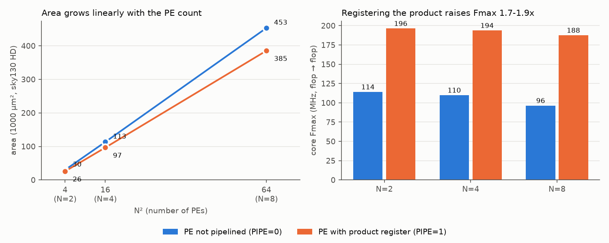

# Systolic-Array INT8 GEMM Accelerator

A parameterized **N×N output-stationary systolic array** for signed INT8 matrix
multiplication with an **AXI4-Stream** interface, verified with **cocotb + pyuvm**,
checked with **formal properties (SymbiYosys)**, synthesized with **Yosys** on the
**SkyWater 130 nm** library, and analysed with a **cycle-accurate model** and a
**roofline performance model**.

> Status: work in progress. See [`PATHWAY.md`](PATHWAY.md) for the plan and progress.

---

## Architecture

```
            B[k][0]  B[k][1]  B[k][2]  B[k][3]       (top edge, skewed by column)
               |        |        |        |
A[0][k] ---> [PE00]-->[PE01]-->[PE02]-->[PE03]
               |        |        |        |
A[1][k] -D-> [PE10]-->[PE11]-->[PE12]-->[PE13]       D = one-cycle skew register
               |        |        |        |
A[2][k] -DD> [PE20]-->[PE21]-->[PE22]-->[PE23]       each PE:  acc += a * b
               |        |        |        |                    forward a ->, b v
A[3][k] DDD> [PE30]-->[PE31]-->[PE32]-->[PE33]
```

* **Output-stationary:** each PE keeps one element of C in its accumulator.
* **Skew buffers:** row *i* / column *j* are delayed *i* / *j* cycles so that
  `A[i][k]` and `B[k][j]` meet in `PE(i,j)`.
* **Global enable:** input bubbles (`tvalid=0`) freeze the whole pipeline, so
  stalls never corrupt results.

### Interface

| Port | Width | Meaning |
|---|---|---|
| `s_axis_tdata` | `2·N·8` | beat *k*: column *k* of A (low half) + row *k* of B (high half) |
| `s_axis_tlast` | 1 | last beat of the job (k = K−1) |
| `m_axis_tdata` | `N·32` | one row of C per beat |
| `m_axis_tlast` | 1 | last row |
| `last_job_cycles` | 32 | measured latency of the previous job |

### FSM

`CLEAR → LOAD (K beats) → DRAIN (2N-2 cycles, 1 if N=1) → OUTPUT (N rows) → CLEAR`

Latency without stalls: **K + DRAIN + N cycles** = K + 3N - 2 for N >= 2 (verified in simulation).

---

## Repository layout

```
rtl/            pe.sv, skew_buffer.sv, systolic_array.sv, sa_top.sv (+ formal props)
model/          sa_cycle_model.py   cycle-accurate Python mirror of the RTL
tb/common/      sa_utils.py         packing, golden model, AXI-Stream driver/monitor
tb/cocotb/      test_sa_top.py      directed + random + stall/back-pressure tests
tb/pyuvm/       test_sa_pyuvm.py    UVM-style env: agent, driver, monitor, scoreboard, coverage
formal/         sa_top.sby          SymbiYosys prove + cover
synth/          run_synth.sh, sweep_fmax.sh, area_breakdown.sh, sta.tcl, abc_speed.script
                                    Yosys synthesis (sky130) + OpenSTA timing
analysis/       perf_model.py, summarize_synth.py, merge_coverage.py, bug_injection.py
docs/           bug_injection.md    which test catches which injected RTL bug
setup/          install_tools.sh, check_tools.sh
```

## Quick start (WSL2 Ubuntu)

```bash
bash setup/install_tools.sh          # one time
source ~/.bashrc
make check                           # confirm the toolchain
make model                           # cycle-model self-test (numpy only)
make test                            # cocotb regression, N=4
make sweep                           # N = 2, 4, 8
make uvm                             # pyuvm regression
make cov                             # pyuvm at N = 2, 4, 8 + merged coverage closure check
make bugs                            # bug-injection check of the testbenches
make formal                          # SymbiYosys
make synth                           # Yosys + sky130 + OpenSTA (PIPE=0|1, CLK_PERIOD=<ns>)
make fmax                            # PIPE=0 vs PIPE=1: area, Fmax, plot
make perf                            # performance model + plots in results/
```

## Verification

| Layer | What it checks |
|---|---|
| cocotb (7 tests) | identity, K=1, extreme values, 50 back-to-back jobs with the exact latency `K + DRAIN + N`, random bubbles + back-pressure, reset mid-job |
| cycle-accurate lockstep | `test_cycle_accurate_vs_model` compares `tready`, `tvalid`, `tlast`, `last_job_cycles` and `tdata` with `model/sa_cycle_model.py` on **every clock cycle**, with garbage on `tdata`/`tlast` while `tvalid` is low |
| pyuvm (3 tests) | agent / driver / monitor / scoreboard against a NumPy golden model: random + corner, random stalls, and directed stall patterns (valid toggling every cycle, long gaps, `tready` held low 8 / 30 / 50 cycles mid-output) |
| functional coverage | 27 bins (K, K vs N, operand extremes, sign mix, input bubbles per job, back-pressure cycles per job, stall patterns), merged over the tests by `make cov`; closure is checked per N |
| formal (SymbiYosys) | 7 properties proved by k-induction (AXI-Stream output stability, no input while producing output, `tlast` framing, row index range, FSM returns to CLEAR, accumulators frozen when stalled, `tready` low during DRAIN); a cover trace completes a job |
| bug injection | 12 one-line RTL mutations, all caught - see [docs/bug_injection.md](docs/bug_injection.md) |

All of it passes for N = 2, 4, 8. Two examples of why the layers are needed: a DRAIN that is one
cycle too long is functionally correct and only a latency check or the lockstep test sees it;
`tready` high during DRAIN is invisible to the cocotb tests (they send the next job only after
the previous one has finished) and is caught by the lockstep test and by the pyuvm driver, which
overlaps jobs.

## Results

All numbers: SkyWater sky130 HD, typical corner (tt, 25 C, 1.8 V), Yosys + ABC (timing-driven, fan-out
buffered, `lpflow_*` cells excluded), OpenSTA 2.3.1 on the synthesized netlist. Ideal clock, zero I/O
delay, no placement or wire parasitics, so these are pre-layout estimates. Fmax is flop-to-flop
(`1000 / (period - slack)`).

| N | Tests | Cells | Area (µm²) | Fmax (MHz) | Peak GOPS @ Fmax |
|---|---|---|---|---|---|
| 2 | 7 cocotb + 3 pyuvm, all pass | 3,142 | 25,717 | 196.4 | 1.6 |
| 4 | 7 cocotb + 3 pyuvm, all pass | 11,555 | 96,545 | 193.8 | 6.2 |
| 8 | 7 cocotb + 3 pyuvm, all pass | 47,228 | 385,388 | 187.6 | 24.0 |

(PIPE=1, the shipped configuration. Peak GOPS = 2 x N² x Fmax: one MAC = 2 ops per PE per cycle.)

### PE pipelining: before / after

`PIPE=0` adds the product to the accumulator in the same cycle; `PIPE=1` registers the product first
(`prod_r` in `rtl/pe.sv`) and adds it one cycle later. Cost: one extra DRAIN cycle, so latency goes from
`K + 3N - 2` to `K + 3N - 1` (N >= 2).

| N | Area PIPE=0 (µm²) | Area PIPE=1 (µm²) | Fmax PIPE=0 (MHz) | Fmax PIPE=1 (MHz) | Fmax gain |
|---|---|---|---|---|---|
| 2 | 29,951 | 25,717 | 114.2 | 196.4 | 1.72x |
| 4 | 113,347 | 96,545 | 110.0 | 193.8 | 1.76x |
| 8 | 453,150 | 385,388 | 96.5 | 187.6 | 1.94x |



* **Critical path before** (N=4, 9.1 ns): operand register -> AND partial products -> compressor tree of the
  multiplier -> ~30 `maj3` carry stages of the 32-bit accumulate -> accumulator register. That is the
  expected multiplier -> adder -> register path.
* **Critical path after** (5.2 ns): operand register -> multiplier -> `prod_r`. The accumulate stage is no
  longer on the critical path; the multiplier alone now limits Fmax, so the next step would be to split the
  multiplier itself (Booth encoding / a carry-save stage).
* **Why the pipelined design is also smaller** (−15 % at N=8) even though it has 256 more flops: with
  `PIPE=0` Yosys merges each PE's multiply and add into a single `$macc` cell (visible in the synthesis
  log), a larger structure than a separate multiplier and adder. The register breaks that merge. This is a
  tool effect, so it should not be generalised to other flows.
* **What dominates the area** (N=8, hierarchical run, `synth/area_breakdown.sh`): the 64 PEs are 90 % of the
  total (5,617 µm² each: 28 % flops, 72 % combinational multiplier + adder + enable muxes), the two skew
  buffers 5 %, the top-level control and output row mux 5 %. Area per PE is ~6,000 µm² at N=4 and N=8, i.e.
  area is linear in N².
* **Other path groups.** The AXI inputs feed the global `en`, which fans out to every register. Without
  buffering that net alone gave a 170 ns "critical path", which is a flow artifact: the timing-driven ABC
  script (`synth/abc_speed.script`) buffers and sizes it. With `PIPE=1` the input-to-register slack is
  positive at every size, so the core is the limit; with `PIPE=0` the input path (which also runs
  through the multiplier) is only 0.3-0.7 ns behind it.
* **Caveats.** Clock is ideal and I/O delays are zero. The mapped result did not change with the clock
  target (3, 5 and 8 ns gave the same netlist at N=4), so one target is used. Synthesis only: there is no
  placement, routing, or wire load yet (OpenLane would add those).
